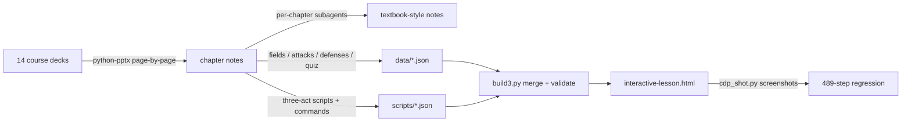

# Network Protocol Security · Interactive Lesson

[中文](README.md) · **English**

A byte-level interactive teaching page rewritten from a university course deck: **24 protocols**, each played out in three acts — *normal operation → under attack → defense kicks in*. Every packet is broken down field by field down to the byte, and every step ships with a command you can actually run to reproduce it.

Open it by double-clicking [`interactive-lesson.html`](interactive-lesson.html) in the repo root (987 KB single file, offline, no external dependencies, no server needed).

---

## What it looks like

| Area | Content |
|---|---|
| Protocol nav | Grouped by layer: link / network / transport / application / extension — 24 protocols |
| Three acts | Act 1 normal operation, Act 2 one or two attack scenes (attacker node and arrow turn red), Act 3 replays the same attack and shows exactly which step the defense cuts it off |
| Stage, left | Topology nodes, animated dashed arrow, packet badge — who sends what to whom at this step |
| Stage, right | Wireshark-style tree: **Chinese name · English name → value at this step → byte range → `?`**, a one-line gray note underneath, `?` expands the full mechanism plus a red "security view" line |
| Bottom | Real hex + ASCII, colored by layer; hovering a tree field and the corresponding bytes highlight each other |
| Per-step commands | Collapsible "hands-on" panel: Linux / PowerShell / CMD, each with what it does, how to read the output, one-click copy |
| Collapsible panels | Deep read, full field table, defenses and their limits, quiz |

Scale: **24 protocols / 489 steps / 599 commands / 750 fields**.

## How it works



- The renderer is written **once** (`src3/app.js` + `src3/style.css`); everything else is data — packet bytes and field offsets (`data/*.json`), three-act scripts with per-step packet index, highlighted fields, semantic values and commands (`scripts/*.json`).
- The page is a **single self-contained front-end file**: the build inlines JSON, CSS and JS into the HTML, so `file://` works with no CORS issues.
- Field notes are namespaced as **`protocol::field`**: `Source Address` means a MAC in Ethernet but an IP address in IPv4, so a shared namespace would leak notes across pages.

## Layout

```
interactive-lesson.html   build output — the single-file page
build3.py                 builder: merges data + scripts, validates field names / step counts / commands
SPEC3.md                  script data spec (follow it when adding a protocol)
data/                     per-protocol packets and fields (hex + offsets + bit fields + description)
scripts/                  per-protocol three-act scripts (steps, highlighted fields, commands)
src3/                     renderer (app.js / style.css / template / notes.json)
notes/                    chapter notes + index + coverage gap report
```

## Rebuild

```bash
python build3.py interactive-lesson.html
```

The build validates that every step's `pkt` index exists, `hl`/`vals` field names match the packet verbatim, `say` ≤ 60 characters, step counts are in range, and every scene has all three command environments.

## Sources and limits

- Notes and scripts are **rewritten** from 14 course decks (1787 slides); the repository contains **no course material itself**.
- Field lengths, bit layouts and attack details are checked against the RFCs (791 / 9293 / 826 / 792 / 4302 / 4303 / 8446 / 9000 / 1035 / 2131 …).
- Commands follow the author's personal Obsidian system notes (`ss`, `ip`, `curl`, `netstat`, `netsh`, `arp`, `Test-NetConnection`, `Get-NetTCPConnection` …); tools those notes don't cover (tcpdump, nmap, dig, openssl, hping3) are labelled "supplementary" in the page.
- All sample packets use documentation/test ranges (192.168.x, 203.0.113.x, example.com); no real host is involved.

## Known gaps

The page is protocol-centric, so **chapter 1 (overview) has no entry**: network definition and history, the five security properties, risk as asset × threat × vulnerability, Chinese regulation, IoT/ICS protocols, and career/methodology content. Application-layer cross-cutting summaries, SAVA background, the exam cram tables and per-chapter confusion tables are also missing. See [`notes/v4遗漏说明.md`](notes/v4遗漏说明.md) (Chinese) for the itemized list and how to add each one.

## Use and license

Personal study material; **no open-source license is attached** (all rights reserved). Please credit the source when quoting or redistributing. Rights to the course content itself belong to the instructor and the university.
