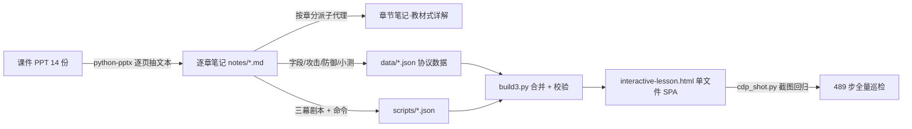

# 网络协议安全 · 交互课堂

**English** · [README.en.md](README.en.md)

一个从课程课件重写出来的**字节级交互教学页**：24 个协议，每个都按「正常运转 → 被攻击 → 防护生效」三幕演一遍，报文按字段拆到字节，每一步都能照着敲命令验证。

打开方式：双击仓库根目录的 [`interactive-lesson.html`](interactive-lesson.html)（单文件 987 KB，离线、无外部依赖、不需要服务器）。

---

## 它长什么样

| 区域 | 内容 |
|---|---|
| 顶部协议导航 | 按层分组：接口层 / 网络层 / 传输层 / 应用层 / 拓展，共 24 个协议 |
| 三幕 | 第 1 幕正常运转、第 2 幕 1~2 个攻击场景（攻击方节点与箭头变红）、第 3 幕重放同一场攻击并看防护在哪一步掐断 |
| 舞台左栏 | 拓扑节点 + 动态虚线箭头 + 报文浮标，指示这一步谁发给谁 |
| 舞台右栏 | Wireshark 式报文结构树：**中文名 · 英文名 → 本步取值 → 字节范围 → `?`**，下一行灰字短注，点 `?` 展开完整机制与「安全视角」 |
| 底部 | 真实十六进制 + ASCII（按层上色），悬停树字段与字节双向高亮 |
| 每步命令 | 「动手验证」折叠条，Linux / PowerShell / CMD 三套，带作用说明、预期输出怎么读、一键复制 |
| 折叠区 | 深读、字段全表、防护手段与局限、小测 |

数据规模：**24 个协议 / 489 步 / 599 条命令 / 750 个字段**。

## 实现原理



- **渲染器只写一次**（`src3/app.js` + `src3/style.css`），所有内容都是数据：协议报文（`data/*.json`，含 hex 与字段偏移）、三幕剧本（`scripts/*.json`，每步指定包下标、高亮字段、语义值、命令）。
- 页面是**纯前端单文件**：构建时把 JSON、CSS、JS 内联进 HTML，所以 `file://` 直接打开就能用，没有 CORS 问题。
- 字段短注按 **`协议::字段`** 隔离：`Source Address` 在以太网是 MAC、在 IP 是地址，不做隔离就会串注。

## 目录结构

```
interactive-lesson.html   构建产物：单文件交互页（双击即开）
build3.py                 构建脚本：合并 data + scripts，并校验字段名/步数/命令
SPEC3.md                  剧本数据规范（写新协议时照这个格式）
data/                     24 个协议的报文与字段（hex + 偏移 + 位域 + 描述）
scripts/                  24 份三幕剧本（步骤、高亮字段、命令）
src3/                     渲染器（app.js / style.css / template / notes.json）
notes/                    逐章笔记（教材式详解）+ 索引 + 覆盖差异说明
```

## 重新构建

```bash
python build3.py interactive-lesson.html
```

构建时会校验：每步的 `pkt` 下标存在、`hl`/`vals` 字段名与报文逐字一致、`say`≤60 字、步数区间、每场景三套命令齐全；缺剧本的协议会被列出来。

## 内容来源与边界

- 笔记与剧本都基于课程课件（14 份 PPT，1787 页）**重写整理**，不是课件原文，**仓库不含任何课件文件**。
- 报文字段的长度、位域与攻击细节按 RFC 原文（791 / 793→9293 / 826 / 792 / 4302 / 4303 / 8446 / 9000 / 1035 / 2131 等）核对。
- 每步的实践命令对齐 Obsidian《系统》笔记里的写法（`ss`、`ip`、`curl`、`netstat`、`netsh`、`arp`、`Test-NetConnection`、`Get-NetTCPConnection` 等）；课件与笔记都没收录的工具（tcpdump、nmap、dig、openssl、hping3…）在页面里标为「补充」。
- 示例报文中的 IP、MAC、邮箱域名均为文档/测试网段（192.168.x、203.0.113.x、example.com），不含任何真实主机。

## 已知局限

页面是「以协议为中心」的，所以**第一章概述类内容没有入口**：网络定义与发展、安全五性、风险三要素、我国法规、物联网与工控协议、AI 时代的岗位结构与学习方法；另有应用层横向总结、SAVA 拓展的背景与落地、冲刺速查三张表、各章易错对比表未进页面。逐条说明与补法见 [`notes/v4遗漏说明.md`](notes/v4遗漏说明.md)。

## 使用与许可

个人学习整理的代码与笔记，未附开源许可证（保留所有权利）。转载、引用或二次分发请注明出处；课程内容的相关权利归授课教师与学校。
